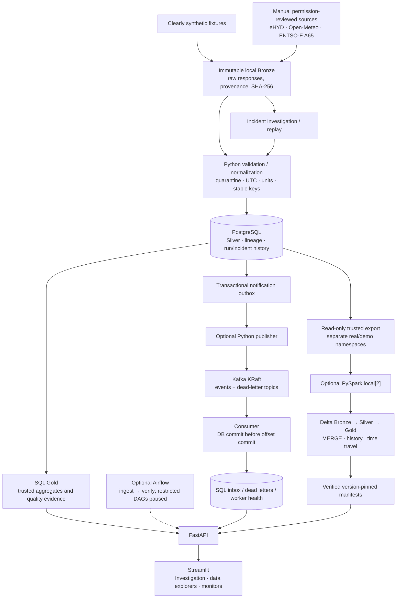

# DanubePulse

### Austrian River, Weather & Energy Data Intelligence Platform

**A local-first data engineering portfolio built around trustworthy data,
incident investigation and verifiable recovery.**

DanubePulse ingests Austrian river readings, historical weather and authorized
electricity-demand forecasts into an auditable Bronze/Silver/Gold pipeline.
Its distinguishing feature is a **Data Incident Investigation and Replay Engine**:
simulate a failure, trace its analytical impact, repair from retained evidence,
and verify the persisted result rather than just changing an incident's status.

The core runs on a laptop with PostgreSQL, FastAPI and Streamlit. Airflow,
Kafka and a PySpark/Delta lakehouse are optional extensions, not prerequisites.
The demonstration works without provider credentials or live ingestion.

> **Publication preparation, not a released public repository.** A database
> backup remains reachable in historical commits/tags. Public publication is
> blocked pending separately approved history/data cleanup. Code licensing is
> also pending owner review; no MIT license is currently granted.
> See the [publication checklist](docs/publication.md).

## Portfolio highlights

| Engineering problem | Implemented approach |
|---|---|
| Detect unreliable data | Schema/type/unit/range/null, duplicate, completeness and freshness checks |
| Explain and repair failures | Schema drift, duplicate records and missing/late-event investigation with before/after verification |
| Reprocess safely | Immutable Bronze, stable identities, retained lineage, idempotent Silver and SQL Gold |
| Handle energy correctly | UTC intervals, DST-aware display, duration-weighted averages, MW-to-MWh integration and provider revisions |
| Automate without duplicating logic | Thin Airflow DAGs call the existing pipeline and independently verify persisted results |
| Publish notifications despite broker outages | Transactional outbox, Kafka retries, idempotent SQL inbox, manual offset commits and durable dead letters |
| Demonstrate lakehouse engineering honestly | Optional local Spark, Delta MERGE, schema enforcement, transaction history and time travel |
| Prove the result | SQLite/PostgreSQL tests, FastAPI/Streamlit tests, real Docker Kafka and Delta contracts |

This is a working portfolio system, not a claim of production high availability.
Current data volumes do not require Spark; Kafka carries pipeline notifications,
**not live external measurements**.

## Architecture



See [architecture and design trade-offs](docs/architecture.md) for boundaries,
transaction guarantees, storage ownership and failure paths.

## Technology stack

| Core | Optional extensions | Quality and delivery preparation |
|---|---|---|
| Python 3.12, pandas, SQLAlchemy/psycopg | Apache Airflow 3.3.2 | pytest, Ruff, Alembic |
| PostgreSQL 16, SQL analytical views | PySpark 3.5.6 / Delta Lake 3.3.2 | SQLite and PostgreSQL regression suites |
| FastAPI, Streamlit, Altair | Apache Kafka 4.1.2 / confluent-kafka 2.12.2 | GitHub Actions, redacted Gitleaks, publication path checks |
| Docker Compose, structured logging | Local single-node profiles | No cloud deployment or registry publication yet |

## Quick start: offline synthetic demo

Requires Docker Engine/Desktop with Compose v2. Run only the core services;
allow several GiB of RAM and run optional workloads separately on WSL laptops.
Image/package downloads require internet initially; demo ingestion does not.

### Fresh checkout only

1. Copy the example configuration locally:

   ```bash
   cp .env.example .env
   ```

2. Edit the ignored `.env`: set a private **URL-safe** `POSTGRES_PASSWORD`,
   retain `DATA_MODE=demo`, leave the provider token empty and retain
   `ENTSOE_TERMS_ACCEPTED=false`. Never share this file or expanded Compose output.

3. Generate a private token for guarded synthetic actions:

   ```bash
   python3 scripts/setup_demo_control.py
   export DATA_MODE=demo
   ```

4. Start the core:

   ```bash
   docker compose up -d --build --wait db api dashboard
   ```

5. Open [Streamlit](http://localhost:8501), click **Load synthetic demo**, then
   explore **Incident Investigation** or the [interview demo](docs/demo.md).
   [API docs](http://localhost:8000/docs)
   and [health](http://localhost:8000/health) are also available.

The shell-only `DATA_MODE=demo` override disables live-ingestion endpoints
without changing an existing `.env`; keep that shell for Compose commands.
All published local ports bind to loopback. Guarded synthetic mutation routes
require the private token; the app has no general user authentication layer and
must not be exposed directly to the internet.

**Existing installation:** do not overwrite `.env` or rotate the initialized
database password blindly. Retain the existing volume's credentials and
create/test-restore backups before upgrades: normal API startup applies migrations.
Do not delete volumes or run destructive reset commands. `docker compose stop`
stops services while retaining data.

The image includes synthetic fixtures; no manual container copy is needed.
Core behavior is unchanged when Kafka is stopped.

### Python / SQLite alternative

From the repository with Python 3.12, and **without a private PostgreSQL `.env`**:

```bash
python3.12 -m venv .venv
.venv/bin/pip install -e '.[dev]'
.venv/bin/danubepulse migrate
.venv/bin/danubepulse demo
.venv/bin/uvicorn danubepulse.main:app --reload
# In a second terminal:
.venv/bin/streamlit run dashboard/app.py
```

SQLite is the default when `DATABASE_URL` is unset. Configuration in an existing
`.env` may override that default. The fixtures are repository-relative unless
`FIXTURE_DIR` is configured explicitly.

## Demonstrate investigation and recovery

In demo mode select a scenario, simulate it, inspect failed checks/affected
records, investigate, and **Execute recovery and verify**.

| Scenario | Failure and repair | Proof |
|---|---|---|
| Schema drift | Unexpected `water_level_cm`; quarantine, field mapping and replay | Original failed validation remains; new validation and trusted persisted row succeed |
| Duplicates | Reproducible extra station/event reading; retain physical history but exclude duplicate from trusted analytics | Fresh demonstration Gold count changes **5 → 4**, with recalculated means; repeat replay is idempotent |
| Missing / late | Incomplete temporal coverage and delayed event; backfill/recompute | Event time is distinct from ingestion time; affected aggregates and coverage are reverified |

Reset restores synthetic scenario state without deleting Bronze or audit history.
An already-deduplicated legacy incident may correctly show unchanged metrics;
verification checks actual persisted state, not a manufactured before/after change.
See the [incident investigation learning guide](docs/incident-investigation.md).
For a timed interview walkthrough and safe startup/shutdown commands, see the
[interactive demo guide](docs/demo.md).

## Real data versus synthetic data

| Source/product | Actual scope and current status | Publication boundary |
|---|---|---|
| Austrian eHYD OGC current gauges | Verified connector for Achleiten, Linz and Kienstock; current water level/discharge, not historical hourly access | Polling permission unresolved; river DAG paused; redistribution license not established |
| Open-Meteo Historical Weather | Verified historical model/reanalysis estimates, **not local station readings** | CC BY 4.0 data attribution; free API non-commercial terms require intended-use review |
| ENTSO-E A65/A01 | Genuine Austrian national **day-ahead load forecast**, independently verified historical ingestion | Manual per-run permission review; not measured demand or power-plant output |
| ENTSO-E A75/A44 | Implemented generation/price parsing/import and validation | Live entitlements/reuse not established; remain gated; no fabricated live values |
| APG direct API | Documentation/access investigation | Not connected; approved API specification and permissions still required |
| Demo/test/scale fixtures | Fabricated and prominently labeled | Separate from real namespaces; no claim of external observation |

All internal timestamps use UTC; the UI displays Europe/Vienna with offsets
through DST changes. Nulls are not zeros. Energy prices use EUR/MWh; power MW is
integrated over actual interval duration to MWh. National/regional production
never represents an individual plant. **Correlation does not establish causation.**

`gold_daily_observations` is demo-only; `gold_real_*` views are real-only.
Real mode disables synthetic mutation controls without deleting existing data.
Switching mode is explicit; it does not fetch providers automatically.

Keep `ENTSOE_TERMS_ACCEPTED=false`, A75/A44 restricted, and river/energy Airflow
DAGs paused. Do not copy private source exports or derived real datasets into
Git. Read [source attribution and publication restrictions](docs/data-sources.md)
and the [energy permission guide](docs/energy.md) before any real import or release.

## Optional profiles

Start with the core; use only the extension needed for a demonstration.

```bash
# Lakehouse: trusted PostgreSQL export only; no provider requests.
docker compose --profile lakehouse build lakehouse
docker compose --profile lakehouse run --rm lakehouse run --scope demo
docker compose --profile lakehouse run --rm lakehouse benchmark --sizes 10000 100000

# Kafka: durable pipeline notifications only.
docker compose --profile kafka build streaming-publisher streaming-consumer
docker compose --profile kafka up -d kafka kafka-init streaming-publisher streaming-consumer
```

- [Airflow operations](docs/airflow.md): optional scheduler, isolated metadata,
  retries, concurrency locks and independent persisted-state verification.
  Weather is enabled by default when its scheduler runs; do not start the
  scheduler for an offline/public demo without an explicit polling review.
- [Lakehouse guide](docs/lakehouse.md): full trusted snapshot extraction,
  incremental Delta persistence, schema rejection, history/time travel and
  synthetic-only scale benchmarks. No distributed-speedup claim.
- [Streaming guide](docs/streaming.md): outbox/inbox, outage recovery, replay,
  DLQ and health. **At-least-once**, not end-to-end exactly-once.

## Validation and CI

```bash
.venv/bin/pytest -o addopts='' -q
.venv/bin/ruff check .
.venv/bin/ruff format --check .
python3 scripts/check_publication.py
docker compose --profile airflow --profile lakehouse --profile kafka config --quiet
```

Set `TEST_DATABASE_URL` privately to run the same suite against local PostgreSQL.
Each test migrates a unique disposable schema; production observations are not
reset. Tests block non-loopback network connections so accidental provider calls
fail rather than ingesting live data.

[GitHub Actions](.github/workflows/ci.yml) separates application/PostgreSQL,
Airflow, Spark/Delta, Kafka and publication-safety jobs. It uses no private API
credentials and publishes no images or deployment. Initial dependency/image
downloads still require network access. The full-history publication gate
**intentionally fails** while the historical backup remains; do not hide that
failure or claim the entire pipeline is green. Hosted workflow results are
unverified until a separately approved push.

See [publication checks and local validation](docs/publication.md) for the audit,
release blockers and reproducible commands.

## Deployment direction

No cloud resources exist as a result of this stage. The
[future deployment and cost plan](docs/cloud-deployment.md) describes an
authenticated synthetic-only portfolio demo first, then a private managed-data
architecture if justified. Optional infrastructure is intentionally not kept
running merely to demonstrate a technology.

## Repository map

| Path | Purpose |
|---|---|
| `src/danubepulse/` | Connectors, quality, persistence, replay, API and notification workers |
| `dashboard/` | Streamlit data explorers and operational monitors |
| `migrations/` | Operational and analytical schema history |
| `tests/` | Offline application/connector/API/Streamlit and PostgreSQL contracts |
| `airflow/`, `lakehouse/`, `streaming/` | Optional workloads and integration checks |
| `data/fixtures/` | Small explicitly fabricated demonstration inputs |
| `docs/` | Architecture, learning/operations guides, terms and release preparation |

## Licensing and safe publication

**Code licensing is pending owner review.** There is no project `LICENSE` file;
do not describe the repository as MIT-licensed or fully open-source yet.
The fabricated demo fixtures carry their own documented CC0 label; that does
not license provider measurements, dependencies or the application code.
Upstream terms and attribution remain independent of any future code license.

Before publication, resolve the historical backup, choose a code license,
review data redistribution and scan the exact refs intended for release.
No commit, push, repository publication or final milestone is performed in Stage 8A.


## Copyright and usage

Copyright © 2026 DanubePulse project author. All rights reserved.

DanubePulse is publicly available for portfolio review and demonstration purposes, including evaluation by potential employers and recruiters.

The original project source code is not offered under an open-source license. Public availability does not grant permission to reuse, modify, redistribute, or commercially exploit the code, except as permitted by applicable law or GitHub's Terms of Service.

The fabricated demonstration fixtures are separately designated CC0-1.0. Third-party software and external data sources remain subject to their respective licenses, copyright notices, and usage terms.