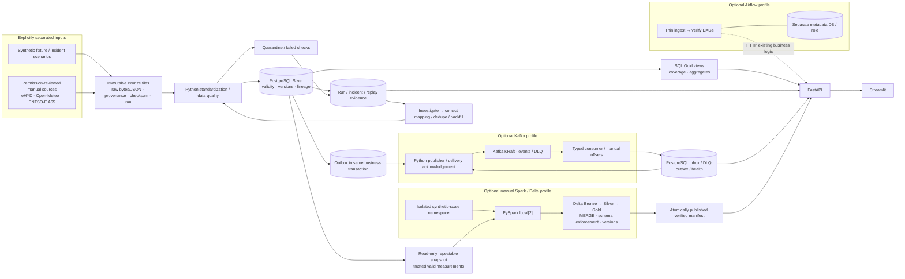

# Architecture and engineering boundaries

DanubePulse is a local-first, production-style portfolio, not a claim of a
production SLA. PostgreSQL is authoritative. Optional components demonstrate
specific operational practices without making the core depend on them.

## Storage and transaction ownership

| Boundary | Guarantee | Important limit |
|---|---|---|
| Source Bronze | Retained response, request/run metadata and checksum | Local disk is not replicated durable object storage |
| Silver / audit / notification outbox | SQL transactions, constraints and quality statuses | Source fetch/file write and database commit are not one distributed transaction |
| Gold | SQL queries reflect trusted persisted Silver | Missing data is not zero or proof of complete coverage |
| Incident recovery | Flush corrections; verify database rows and aggregates; retain old failures | Recovery status alone is not proof; see replay verification tests |
| Kafka publication | ACK before marking outbox published; retries survive outages | ACK-to-DB-commit window can redeliver |
| Kafka consumption | DB receipt before offset commit; UUID deduplication | At-least-once, no end-to-end exactly-once claim |
| Delta | ACID per table, enforced schema and version-based reads | No atomic transaction across Bronze/Silver/Gold |
| Lakehouse presentation | Last verified manifest pins table versions | Latest physical table pointers may advance during a failed job |

## Data contracts

- **Real and synthetic** observations have separate source provenance and SQL
  views; lakehouse directories and streaming labels preserve the distinction.
- **Event time, ingestion time and processing time** are separate. All internal
  times are UTC; Europe/Vienna display preserves DST offsets.
- ENTSO-E XML document creation metadata is retained but is not assumed to be
  the original forecast publication time. Metadata-only repeats do not create
  unnecessary Silver versions.
- An energy measurement is an interval with units and product identity.
  Duration weighting distinguishes MW, MWh and EUR/MWh.
- Kafka events are pipeline facts, not sensor readings. A replay does not
  relabel historical notifications as fresh measurements.
- Lakehouse Bronze is a trusted PostgreSQL export with original Bronze
  references, not a second unvalidated provider connector. Full snapshot reads
  feed incremental table persistence; this is not CDC.

## Operational isolation

- Base Compose runs PostgreSQL, FastAPI and Streamlit only.
- Airflow uses separate metadata storage and reuses existing HTTP pipeline
  operations. River and energy are paused; starting weather scheduling requires
  intended-use/provider review.
- Kafka has no host-published port. Worker images install the optional client;
  the core API reads monitoring tables without contacting Kafka.
- Spark is an exit-on-completion job, bounded to two local threads. Benchmarks
  use synthetic-only namespaces and make no multi-node performance claim.
- API/dashboard/PostgreSQL/Airflow UI host ports bind to loopback. Local binding
  is not authentication; public deployment requires an explicit security design.

## Design trade-offs and deferred work

The current small datasets justify PostgreSQL more than distributed compute.
Spark/Delta and Kafka are practical learning extensions with correctness tests,
not replacements for simple SQL. Airflow is scheduling, not duplicated connector
logic. Local disk/named volumes, one broker and a single DB are affordable for
learning but are not high availability or a disaster-recovery strategy.

Deferred: approved source redistribution, production identity/access control,
dedicated least-privilege app/worker roles, managed backups, operational alerting,
dependency lock/update policy and deployed CI/CD. See the
[cloud plan](cloud-deployment.md) and [publication gate](publication.md).
