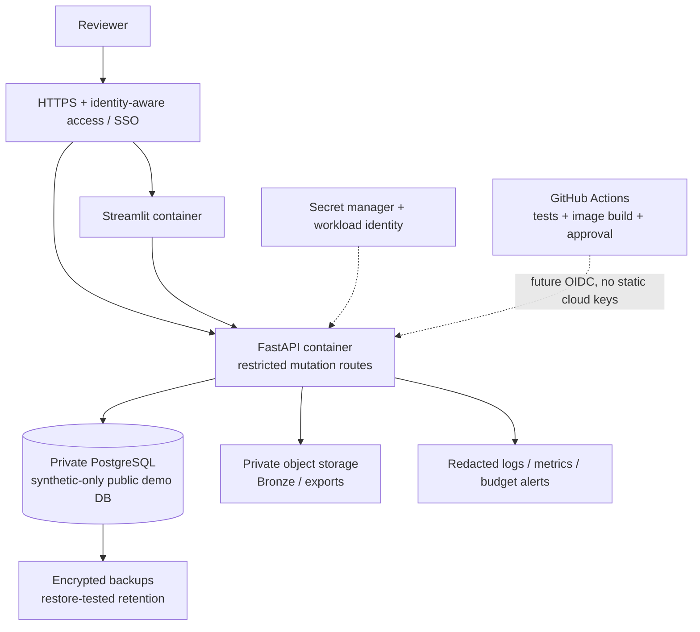
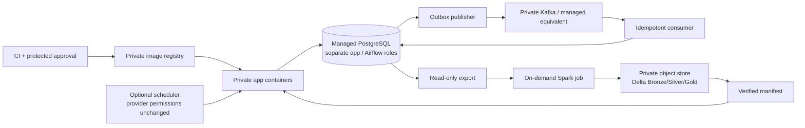

# Future cloud deployment: design and cost considerations

**Planning only. No cloud account, infrastructure, deployment credentials,
container registry publication or paid resource is created by Stage 8A.**
The local application is not presently suitable for direct internet exposure.
This plan does not authorize provider polling or redistribution.

## Recommended first portfolio deployment

Use a **synthetic-only, authenticated, temporary demonstration**. Do not move
the current private PostgreSQL volume or real Bronze files to a public demo.
Prove the core first; keep Airflow, Kafka and Spark off unless a specific demo
requires them. A smaller architecture is a stronger choice than idle services.

Changing local file paths to object storage is implementation work, not a
configuration-only promise. Current local-volume locks, lakehouse manifest reads
and filesystem-based Bronze must be adapted and tested before managed/serverless
deployment. Health probes alone are not authorization or data isolation.

### Small demonstration options

1. **One small VM + Compose:** lowest operational complexity. Reverse proxy,
   TLS, access control, firewall, backups, patching and recovery remain the
   operator's responsibility. Single-host failure risk is explicit.
2. **Managed container runtime + managed PostgreSQL:** less host maintenance,
   but minimum database/network/monitoring costs can exceed the tiny workload's
   compute costs. Streamlit WebSockets and session behavior must be tested.
3. **Static screenshots / recorded synthetic demo plus code:** no running
   cloud infrastructure, the safest initial portfolio option while source
   rights, history cleanup and authentication remain unresolved.

## Private full-platform extension (only if justified)

- Store secrets in a managed secret service and use short-lived workload
  identity. GitHub-to-cloud authentication should use OIDC with narrowly scoped
  roles and protected deployment environments, not long-lived access keys.
- No public PostgreSQL/Kafka ports. Use private networking, least-privilege
  database roles, TLS and Kafka authentication/ACLs.
- Review every data product and intended use before enabling schedules.
  Keep A75/A44 gated and river/energy DAGs paused until separately approved.
- Replace laptop-local volumes and locking assumptions deliberately. Validate
  Delta object-store transaction/log-store support for the chosen storage.
- Introduce PITR/restore drills, retention, migrations with tested rollback,
  deployment health gates, audit access and redacted observability.
- Do not claim exactly-once by moving the outbox to cloud: the SQL/Kafka
  transaction boundary remains at-least-once with idempotent processing.

## Approximate costs (USD, planning envelope)

These are **estimates, not a quote or measured deployment**. Recalculate for the
selected region, currency, taxes, utilization, storage, backup retention and
egress. Free credits/free tiers are not a durable operating model.

| Scenario | Rough monthly budget | Assumptions |
|---|---:|---|
| Local development / static portfolio | $0 cloud runtime | Existing laptop; electricity/internet and optional domain excluded |
| Core-only VM demonstration | $30–80 | One roughly 4–8 GiB VM, modest storage/backups, low traffic; no HA |
| Larger temporary all-components VM | $100–180 | Roughly 16 GiB VM plus storage/backups; prefer shutting it down between demos |
| Small managed core | $80–250 | Low app traffic, single managed PostgreSQL, basic logs/backups/network; provider/region dependent |
| Managed scheduler + Kafka + Spark extensions | $300–1,000+ | Indicative total platform envelope, not a guaranteed minimum/ceiling; idle baselines can dominate |

As one transparent reference, the
[AWS Lightsail pricing page](https://aws.amazon.com/lightsail/pricing/) checked
for this plan lists Linux public-IPv4 bundles at **$24/month for 4 GiB**,
**$44/month for 8 GiB**, and **$84/month for 16 GiB**. These are VM-bundle examples,
not the complete platform cost. Regional availability, transfer limits, backups
and future pricing must be rechecked. An advertised 0.5–1 GiB entry-tier instance
is not a realistic all-components DanubePulse host.

Other useful primary calculators:
[AWS](https://calculator.aws/), [Google Cloud](https://cloud.google.com/products/calculator),
[AWS managed Kafka](https://aws.amazon.com/msk/pricing/) and
[Cloud SQL](https://cloud.google.com/sql/pricing).
No calculator estimate has been provisioned or purchased.

### Frequently missed cost drivers

- Always-on managed database, scheduler and Kafka capacity.
- NAT gateways, load balancers, public IPv4, cross-zone transfer and internet
  egress even when application CPU usage is tiny.
- Object-store requests, Delta small files/old versions, Kafka retention and
  database backup/PITR storage.
- Log ingestion/retention, container registry storage/scanning and CI minutes.
- Paid weather/API subscription or primary-owner licensing for the intended
  promotional/commercial use.
- Domain/TLS operations, patching, incident response and restoration time.

### Cost guardrails before any deployment

Choose a maximum budget and duration, tag resources, configure billing alerts
(which are not spending caps), set log/data lifecycle rules, cap worker sizes
and concurrency, and schedule an explicit review/shutdown. Prove restoration
before applying destructive cleanup to any approved future resource.

## Future delivery gates

1. Resolve publication history and code/data licensing.
2. Run hosted credential-free CI on the approved publication refs.
3. Add dependency lock/update policy, image vulnerability scanning and SBOMs.
4. Add authentication, rate limiting, least-privilege roles and secret handling.
5. Build immutable images; test migrations against a restored staging backup.
6. Require manual deployment approval via a protected environment.
7. Deploy synthetic-only staging, verify functional/restore/security/cost checks,
   then separately approve any public or real-data operation.

No deploy workflow, Terraform apply, cloud credentials or registry push is
included in this stage. CI preparation is not continuous deployment.
